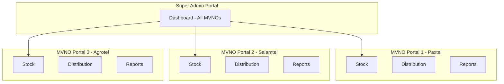
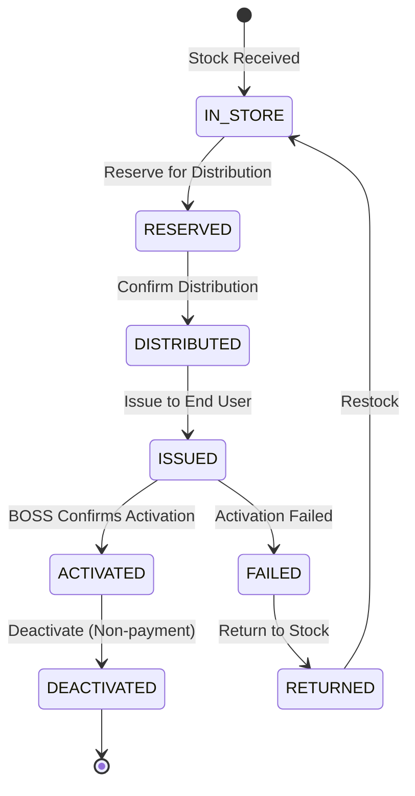
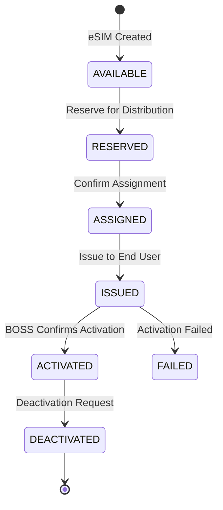
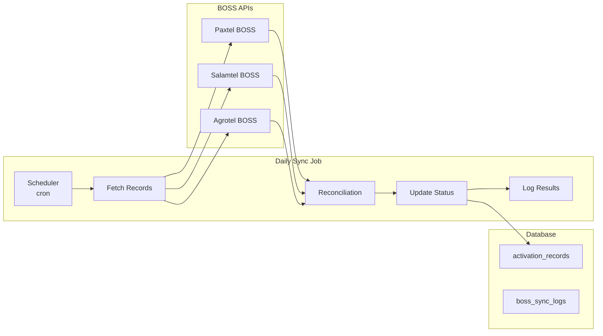
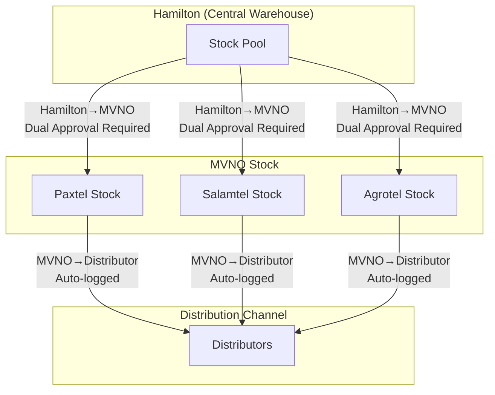
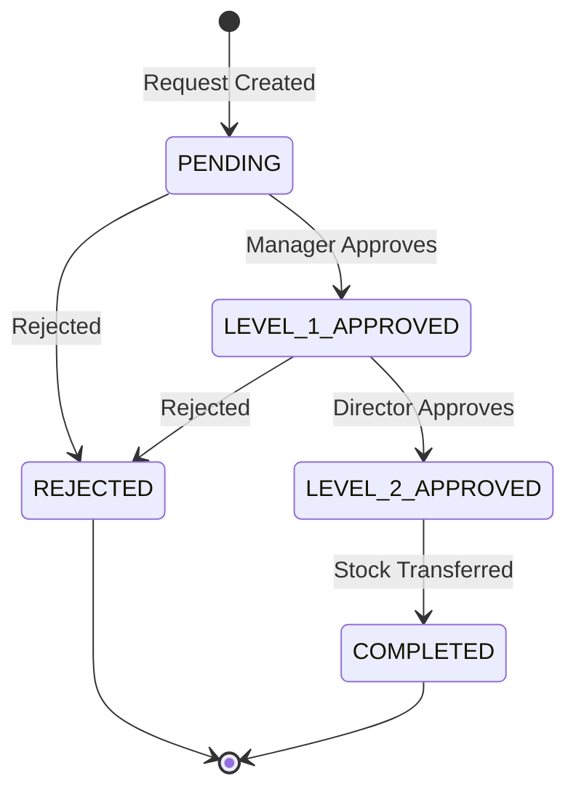

# MVNE Operations Platform - Architecture Design

## 1. Executive Summary

This document outlines the architecture for upgrading the SIM Card Inventory System to a full Multi-Tenant MVNE (Mobile Virtual Network Enabler) Operations Platform. The platform will support multiple MVNOs (Paxtel, Salamtel, Agrotel) with role-based access control, BOSS integration, and comprehensive stock management.

---

## 2. Current System Analysis

### 2.1 Existing Components

| Component | Technology | Status |
|-----------|------------|--------|
| Database | PostgreSQL (Supabase) | Active |
| Frontend | React + TypeScript | Active |
| Auth | Supabase Auth | Basic |
| Stock Tables | cartons, boxes, simcards, esim_stock | Operational |
| Distribution | box_pick_records | Operational |
| Audit | audit_logs (NEW) | Migration 039 |

### 2.2 Current Tables

```
mvnos
├── id (UUID)
├── name (ENUM: PAXTEL, SALAMTEL, AGROTEL, BCC)
└── created_at

distributors
├── id, name, type, location, region
├── mvno_id (nullable - currently not enforced)
└── contact info

cartons
├── id, carton_number, mvno_id
├── imsi_start, imsi_end
├── iccid_start, iccid_end
└── total_boxes, sims_per_box

boxes
├── id, carton_id, box_number
├── iccid_start, iccid_end
├── remaining_sims, issued_sims
└── mvno_id

simcards (legacy)
├── iccid, imsi, phone_number
├── status (IN_STORE, ISSUED, ACTIVATED, etc.)
└── mvno_id, distributor_id, box_id

esim_stock
├── iccid, imsi, mvno_id
├── status
├── issued_to_distributor_id, issued_date
└── distribution_id

box_pick_records
├── box_id, distributor_id
├── sims_picked, iccid_start, iccid_end
└── distribution_id
```

---

## 3. Multi-Tenant Architecture

### 3.1 Tenant Isolation Strategy

**Option: Shared Database, Shared Schema with mvno_id**

This is the recommended approach for MVNE operations due to:
- Lower infrastructure costs
- Simpler backup/restore operations
- Cross-MVNO reporting capabilities
- Easier Super Admin view



### 3.2 Database Schema Updates

All tables MUST include `mvno_id` for tenant isolation:

```sql
-- Tables requiring mvno_id
ALTER TABLE distributors ADD COLUMN IF NOT EXISTS mvno_id UUID REFERENCES mvnos(id);
ALTER TABLE cartons ADD COLUMN IF NOT EXISTS mvno_id UUID REFERENCES mvnos(id);  -- Already exists
ALTER TABLE boxes ADD COLUMN IF NOT EXISTS mvno_id UUID REFERENCES mvnos(id);   -- Already exists
ALTER TABLE simcards ADD COLUMN IF NOT EXISTS mvno_id UUID REFERENCES mvnos(id); -- Already exists
ALTER TABLE esim_stock ADD COLUMN IF NOT EXISTS mvno_id UUID REFERENCES mvnos(id); -- Already exists

-- NEW: Activation Records Table
CREATE TABLE activation_records (
  id UUID PRIMARY KEY DEFAULT gen_random_uuid(),
  mvno_id UUID REFERENCES mvnos(id) NOT NULL,
  iccid TEXT NOT NULL,
  imsi BIGINT,
  distributor_id UUID REFERENCES distributors(id),
  distribution_id UUID,
  activation_status VARCHAR(50) NOT NULL DEFAULT 'PENDING',  -- PENDING, ACTIVATED, DEACTIVATED, FAILED
  activation_date TIMESTAMPTZ,
  deactivation_date TIMESTAMPTZ,
  boss_iccid VARCHAR(22),
  boss_status VARCHAR(50),
  boss_last_check TIMESTAMPTZ,
  failure_reason TEXT,
  retry_count INTEGER DEFAULT 0,
  created_at TIMESTAMPTZ DEFAULT NOW(),
  updated_at TIMESTAMPTZ DEFAULT NOW()
);

-- NEW: Users table with roles
CREATE TABLE platform_users (
  id UUID PRIMARY KEY DEFAULT gen_random_uuid(),
  email VARCHAR(255) UNIQUE NOT NULL,
  password_hash TEXT NOT NULL,
  full_name VARCHAR(255) NOT NULL,
  role VARCHAR(50) NOT NULL,  -- SUPER_ADMIN, MANAGEMENT, MVNO_ADMIN, DISTRIBUTOR
  mvno_id UUID REFERENCES mvnos(id),  -- NULL for Super Admin
  is_active BOOLEAN DEFAULT true,
  last_login TIMESTAMPTZ,
  created_at TIMESTAMPTZ DEFAULT NOW(),
  updated_at TIMESTAMPTZ DEFAULT NOW()
);

-- NEW: API Keys for BOSS integration
CREATE TABLE boss_api_configs (
  id UUID PRIMARY KEY DEFAULT gen_random_uuid(),
  mvno_id UUID REFERENCES mvnos(id) NOT NULL,
  api_name VARCHAR(100) NOT NULL,  -- e.g., "PAXTEL_BOSS", "SALAMTEL_BOSS"
  api_url TEXT NOT NULL,
  api_key TEXT NOT NULL,
  api_secret TEXT,
  is_active BOOLEAN DEFAULT true,
  last_sync TIMESTAMPTZ,
  created_at TIMESTAMPTZ DEFAULT NOW()
);

-- NEW: BOSS Sync Logs for tracking reconciliation jobs
CREATE TABLE boss_sync_logs (
  id UUID PRIMARY KEY DEFAULT gen_random_uuid(),
  mvno_id UUID REFERENCES mvnos(id) NOT NULL,
  sync_type VARCHAR(50) NOT NULL,  -- FULL, DAILY, MANUAL
  status VARCHAR(50) NOT NULL,  -- RUNNING, COMPLETED, FAILED, PARTIAL
  records_processed INTEGER DEFAULT 0,
  records_activated INTEGER DEFAULT 0,
  records_deactivated INTEGER DEFAULT 0,
  records_failed INTEGER DEFAULT 0,
  error_message TEXT,
  started_at TIMESTAMPTZ DEFAULT NOW(),
  completed_at TIMESTAMPTZ,
  duration_seconds INTEGER
);
```

---

## 4. Role-Based Access Control (RBAC)

### 4.1 Role Matrix

| Feature | Super Admin | Management | MVNO Admin | Distributor |
|---------|-------------|------------|------------|-------------|
| **View All MVNOs** | ✅ | ❌ | ❌ | ❌ |
| **View Own MVNO** | ✅ | ✅ | ✅ | ❌ |
| **Manage Users** | ✅ | ✅ | ❌ | ❌ |
| **Manage MVNOs** | ✅ | ❌ | ❌ | ❌ |
| **Create Distributions** | ✅ | ✅ | ✅ | ❌ |
| **View Own Distributions** | ✅ | ✅ | ✅ | ✅ |
| **View All Stock** | ✅ | ✅ | ❌ | ❌ |
| **View Own Stock** | ✅ | ✅ | ✅ | ✅ |
| **Export Data** | ✅ | ✅ | ✅ | ❌ |
| **BOSS Sync** | ✅ | ✅ | ✅ | ❌ |
| **Reports** | Full | Full | Own MVNO | Own Data |

### 4.2 JWT Claims Structure

```json
{
  "sub": "user-uuid",
  "email": "admin@paxtel.com",
  "role": "MVNO_ADMIN",
  "mvno_id": "paxtel-uuid",
  "mvno_name": "PAXTEL",
  "exp": 1234567890
}
```

### 4.3 Row-Level Security (RLS)

```sql
-- Example RLS policy for boxes
CREATE POLICY "mvno_isolation_boxes" ON boxes
  FOR ALL
  USING (
    -- Super Admin sees all
    EXISTS (SELECT 1 FROM platform_users WHERE id = auth.uid() AND role = 'SUPER_ADMIN')
    OR
    -- Others see only their MVNO
    mvno_id = (SELECT mvno_id FROM platform_users WHERE id = auth.uid())
  );
```

---

## 5. Stock Lifecycle

### 5.1 Physical SIM Lifecycle



### 5.2 eSIM Lifecycle



### 5.3 Status Definitions

| Status | Description | Next States |
|--------|-------------|-------------|
| IN_STORE | Stock in warehouse | RESERVED, AVAILABLE |
| RESERVED | Soft-reserved pending confirmation | DISTRIBUTED, ASSIGNED, AVAILABLE |
| AVAILABLE | eSIM ready for distribution | RESERVED |
| DISTRIBUTED | Physical SIM given to distributor | ISSUED |
| ASSIGNED | eSIM assigned to distributor | ISSUED |
| ISSUED | Given to end user | ACTIVATED, FAILED |
| ACTIVATED | Successfully activated on network | DEACTIVATED |
| FAILED | Activation failed | RETURNED |
| DEACTIVATED | Deactivated on network | [*] |
| RETURNED | Returned to stock | IN_STORE |

### 5.4 Soft Stock Reservation Mechanism

To prevent double distribution:

```sql
-- Add reservation columns
ALTER TABLE boxes ADD COLUMN IF NOT EXISTS reserved_sims INTEGER DEFAULT 0;
ALTER TABLE boxes ADD COLUMN IF NOT EXISTS reservation_id UUID;
ALTER TABLE boxes ADD COLUMN IF NOT EXISTS reserved_until TIMESTAMPTZ;

ALTER TABLE esim_stock ADD COLUMN IF NOT EXISTS is_reserved BOOLEAN DEFAULT FALSE;
ALTER TABLE esim_stock ADD COLUMN IF NOT EXISTS reservation_id UUID;
ALTER TABLE esim_stock ADD COLUMN IF NOT EXISTS reserved_until TIMESTAMPTZ;

-- Reservation function
CREATE OR REPLACE FUNCTION reserve_stock(
  p_mvno_id UUID,
  p_sim_type VARCHAR,  -- 'PHYSICAL' or 'ESIM'
  p_quantity INTEGER,
  p_reservation_id UUID DEFAULT gen_random_uuid()
)
RETURNS TABLE(reserved_count INTEGER, message TEXT)
LANGUAGE plpgsql
AS $$
DECLARE
  v_reserved INTEGER := 0;
BEGIN
  IF p_sim_type = 'PHYSICAL' THEN
    -- Reserve from boxes
    UPDATE boxes
    SET reserved_sims = reserved_sims + p_quantity,
        reservation_id = p_reservation_id,
        reserved_until = NOW() + INTERVAL '30 minutes'
    WHERE mvno_id = p_mvno_id
      AND (remaining_sims - reserved_sims) >= p_quantity
      AND (reserved_until IS NULL OR reserved_until < NOW())
    LIMIT 1;
    
    GET DIAGNOSTICS v_reserved = ROW_COUNT;
  ELSE
    -- Reserve eSIMs
    UPDATE esim_stock
    SET is_reserved = TRUE,
        reservation_id = p_reservation_id,
        reserved_until = NOW() + INTERVAL '30 minutes'
    WHERE mvno_id = p_mvno_id
      AND status = 'available'
      AND NOT is_reserved
    LIMIT p_quantity;
    
    GET DIAGNOSTICS v_reserved = ROW_COUNT;
  END IF;
  
  RETURN QUERY SELECT v_reserved, 
    CASE WHEN v_reserved = p_quantity 
      THEN 'Reserved successfully' 
      ELSE 'Partial reservation: ' || v_reserved || ' of ' || p_quantity 
    END;
END;
$$;

-- Release expired reservations (cron job)
CREATE OR REPLACE FUNCTION release_expired_reservations()
RETURNS INTEGER
LANGUAGE plpgsql
AS $$
DECLARE
  v_released_boxes INTEGER := 0;
  v_released_esims INTEGER := 0;
BEGIN
  -- Release box reservations
  UPDATE boxes
  SET reserved_sims = 0,
      reservation_id = NULL,
      reserved_until = NULL
  WHERE reserved_until < NOW()
    AND reserved_sims > 0;
  
  GET DIAGNOSTICS v_released_boxes = ROW_COUNT;
  
  -- Release eSIM reservations
  UPDATE esim_stock
  SET is_reserved = FALSE,
      reservation_id = NULL,
      reserved_until = NULL
  WHERE reserved_until < NOW()
    AND is_reserved = TRUE;
  
  GET DIAGNOSTICS v_released_esims = ROW_COUNT;
  
  RETURN v_released_boxes + v_released_esims;
END;
$$;
```

---

## 6. Financial Fields in Distribution

```sql
-- Add financial fields to box_pick_records (distribution_records)
ALTER TABLE box_pick_records ADD COLUMN IF NOT EXISTS unit_cost NUMERIC(10,2) DEFAULT 0;
ALTER TABLE box_pick_records ADD COLUMN IF NOT EXISTS total_cost NUMERIC(12,2) DEFAULT 0;
ALTER TABLE box_pick_records ADD COLUMN IF NOT EXISTS currency VARCHAR(3) DEFAULT 'UGX';
ALTER TABLE box_pick_records ADD COLUMN IF NOT EXISTS payment_status VARCHAR(50) DEFAULT 'PENDING';  -- PENDING, PAID, UNPAID
ALTER TABLE box_pick_records ADD COLUMN IF NOT EXISTS payment_date TIMESTAMPTZ;
ALTER TABLE box_pick_records ADD COLUMN IF NOT EXISTS invoice_number VARCHAR(50);
ALTER TABLE box_pick_records ADD COLUMN IF NOT EXISTS notes TEXT;

-- Rename for clarity (optional, creates new table)
ALTER TABLE box_pick_records RENAME TO distribution_records;

-- Add transaction type
ALTER TABLE distribution_records ADD COLUMN IF NOT EXISTS transaction_type VARCHAR(50) 
  DEFAULT 'MVNO_TO_DISTRIBUTOR' 
  CHECK (transaction_type IN ('HAMILTON_TO_MVNO', 'MVNO_TO_DISTRIBUTOR'));

-- Add owner tracking for stock traceability
ALTER TABLE boxes ADD COLUMN IF NOT EXISTS owner_type VARCHAR(50);  -- 'HAMILTON', 'MVNO', 'DISTRIBUTOR'
ALTER TABLE boxes ADD COLUMN IF NOT EXISTS owner_id UUID;
ALTER TABLE esim_stock ADD COLUMN IF NOT EXISTS owner_type VARCHAR(50);
ALTER TABLE esim_stock ADD COLUMN IF NOT EXISTS owner_id UUID;
ALTER TABLE cartons ADD COLUMN IF NOT EXISTS owner_type VARCHAR(50);
ALTER TABLE cartons ADD COLUMN IF NOT EXISTS owner_id UUID;

-- NEW: Stock Issuance Requests for Hamilton→MVNO dual approval
CREATE TABLE stock_issuance_requests (
  id UUID PRIMARY KEY DEFAULT gen_random_uuid(),
  mvno_id UUID REFERENCES mvnos(id) NOT NULL,
  requester_id UUID REFERENCES platform_users(id) NOT NULL,
  sim_type VARCHAR(20) NOT NULL,  -- 'PHYSICAL', 'ESIM'
  quantity INTEGER NOT NULL,
  
  -- Status workflow
  status VARCHAR(50) NOT NULL DEFAULT 'PENDING',
  -- PENDING → LEVEL_1_APPROVED → LEVEL_2_APPROVED → COMPLETED
  -- Can be REJECTED at any stage
  
  -- Dual approval tracking
  level_1_approver_id UUID REFERENCES platform_users(id),
  level_1_approved_at TIMESTAMPTZ,
  level_1_approval_token VARCHAR(255),
  level_1_token_expires TIMESTAMPTZ,
  
  level_2_approver_id UUID REFERENCES platform_users(id),
  level_2_approved_at TIMESTAMPTZ,
  level_2_approval_token VARCHAR(255),
  level_2_token_expires TIMESTAMPTZ,
  
  rejection_reason TEXT,
  notes TEXT,
  
  created_at TIMESTAMPTZ DEFAULT NOW(),
  updated_at TIMESTAMPTZ DEFAULT NOW()
);
```

---

## 7. BOSS Reconciliation Engine

### 7.1 Architecture



### 7.2 Sync Function

```sql
CREATE OR REPLACE FUNCTION sync_activation_status(
  p_mvno_id UUID,
  p_date DATE DEFAULT CURRENT_DATE,
  p_sync_type VARCHAR DEFAULT 'DAILY'
)
RETURNS TABLE(
  total_checked INTEGER,
  activated INTEGER,
  deactivated INTEGER,
  failed INTEGER
)
LANGUAGE plpgsql
AS $$
DECLARE
  v_sync_log_id UUID := gen_random_uuid();
  v_count_total INTEGER := 0;
  v_count_activated INTEGER := 0;
  v_count_deactivated INTEGER := 0;
  v_count_failed INTEGER := 0;
  v_start_time TIMESTAMPTZ := NOW();
BEGIN
  -- Insert sync log entry
  INSERT INTO boss_sync_logs (id, mvno_id, sync_type, status, started_at)
  VALUES (v_sync_log_id, p_mvno_id, p_sync_type, 'RUNNING', v_start_time);
  
  -- Get all ISSUED records for this MVNO that need verification
  FOR rec IN
    SELECT ar.id, ar.iccid, ar.distribution_id
    FROM activation_records ar
    WHERE ar.mvno_id = p_mvno_id
      AND ar.activation_status IN ('ISSUED', 'PENDING')
      AND DATE(ar.created_at) <= p_date
  LOOP
    -- Call BOSS API (would be external HTTP call)
    -- Update based on response
    UPDATE activation_records
    SET activation_status = 'ACTIVATED',
        boss_status = 'ACTIVE',
        boss_last_check = NOW(),
        activation_date = NOW()
    WHERE id = rec.id;
    
    v_count_activated := v_count_activated + 1;
  END LOOP;
  
  -- Update sync log
  UPDATE boss_sync_logs
  SET status = 'COMPLETED',
      records_processed = v_count_total,
      records_activated = v_count_activated,
      records_deactivated = v_count_deactivated,
      records_failed = v_count_failed,
      completed_at = NOW(),
      duration_seconds = EXTRACT(EPOCH FROM (NOW() - v_start_time))::INTEGER
  WHERE id = v_sync_log_id;
  
  RETURN QUERY SELECT 
    v_count_total,
    v_count_activated,
    v_count_deactivated,
    v_count_failed;
END;
$$;
```

### 7.3 Activation Rate Calculation

```sql
CREATE OR REPLACE VIEW mvno_activation_rates AS
SELECT 
  mvno_id,
  mvno_name,
  period,
  total_distributed,
  total_activated,
  ROUND(
    (total_activated::NUMERIC / NULLIF(total_distributed, 0)) * 100,
    2
  ) AS activation_rate_percent,
  dead_stock,
  avg_activation_days
FROM (
  SELECT 
    d.mvno_id,
    m.name AS mvno_name,
    DATE_TRUNC('month', d.created_at) AS period,
    COUNT(*) AS total_distributed,
    SUM(CASE WHEN ar.activation_status = 'ACTIVATED' THEN 1 ELSE 0 END) AS total_activated,
    SUM(CASE 
      WHEN ar.activation_status IN ('ISSUED', 'PENDING') 
      AND ar.created_at < NOW() - INTERVAL 
      THEN  '30 days'1 
      ELSE 0 
    END) AS dead_stock,
    AVG(EXTRACT(EPOCH FROM (ar.activation_date - ar.created_at))/86400)::NUMERIC(5,2) AS avg_activation_days
  FROM box_pick_records d
  JOIN mvnos m ON d.mvno_id = m.id
  LEFT JOIN activation_records ar ON ar.distribution_id = d.distribution_id
  GROUP BY d.mvno_id, m.name, DATE_TRUNC('month', d.created_at)
) sub;
```

---

## 8. Stock Aging & Activation Delay Metrics

```sql
-- Stock Aging Report
CREATE VIEW stock_aging_report AS
SELECT 
  mvno_id,
  sim_type,
  aging_bucket,
  COUNT(*) AS count,
  percentage
FROM (
  SELECT 
    mvno_id,
    CASE 
      WHEN sim_type = 'PHYSICAL' THEN 'PHYSICAL'
      ELSE 'ESIM'
    END AS sim_type,
    CASE 
      WHEN days_since_distribution = 0 THEN '0 days'
      WHEN days_since_distribution <= 7 THEN '1-7 days'
      WHEN days_since_distribution <= 14 THEN '8-14 days'
      WHEN days_since_distribution <= 30 THEN '15-30 days'
      WHEN days_since_distribution <= 60 THEN '31-60 days'
      ELSE '60+ days'
    END AS aging_bucket,
    COUNT(*) AS count
  FROM (
    SELECT 
      d.mvno_id,
      CASE WHEN d.box_id IS NULL THEN 'ESIM' ELSE 'PHYSICAL' END AS sim_type,
      d.created_at,
      NOW() - d.created_at AS age,
      EXTRACT(DAY FROM (NOW() - d.created_at))::INTEGER AS days_since_distribution
    FROM box_pick_records d
    WHERE d.created_at >= NOW() - INTERVAL '90 days'
  ) sub
  GROUP BY mvno_id, sim_type, aging_bucket
) aging
GROUP BY mvno_id, sim_type, aging_bucket;

-- Activation Delay Tracking
CREATE VIEW activation_delay_report AS
SELECT 
  mvno_id,
  DATE_TRUNC('day', created_at) AS distribution_date,
  COUNT(*) AS total_distributed,
  AVG(activation_delay_days) AS avg_delay_days,
  MIN(activation_delay_days) AS min_delay_days,
  MAX(activation_delay_days) AS max_delay_days,
  COUNT(CASE WHEN activation_delay_days IS NULL THEN 1 END) AS not_yet_activated
FROM (
  SELECT 
    d.mvno_id,
    d.created_at,
    EXTRACT(DAY FROM (ar.activation_date - d.created_at))::INTEGER AS activation_delay_days
  FROM box_pick_records d
  LEFT JOIN activation_records ar ON ar.distribution_id = d.distribution_id
  WHERE d.created_at >= NOW() - INTERVAL '90 days'
) sub
GROUP BY mvno_id, DATE_TRUNC('day', created_at);
```

---

## 9. Indexing Strategy

```sql
-- Critical indexes for performance
CREATE INDEX IF NOT EXISTS idx_boxes_mvno_id ON boxes(mvno_id);
CREATE INDEX IF NOT EXISTS idx_boxes_carton_id ON boxes(carton_id);
CREATE INDEX IF NOT EXISTS idx_boxes_status ON boxes(status);

CREATE INDEX IF NOT EXISTS idx_esim_stock_mvno_id ON esim_stock(mvno_id);
CREATE INDEX IF NOT EXISTS idx_esim_stock_iccid ON esim_stock(iccid);
CREATE INDEX IF NOT EXISTS idx_esim_stock_status ON esim_stock(status);
CREATE INDEX IF NOT EXISTS idx_esim_stock_reserved ON esim_stock(is_reserved) WHERE is_reserved = TRUE;

CREATE INDEX IF NOT EXISTS idx_cartons_mvno_id ON cartons(mvno_id);
CREATE INDEX IF NOT EXISTS idx_cartons_number ON cartons(carton_number);

CREATE INDEX IF NOT EXISTS idx_distributors_mvno_id ON distributors(mvno_id);
CREATE INDEX IF NOT EXISTS idx_distributors_type ON distributors(type);

CREATE INDEX IF NOT EXISTS idx_activation_records_mvno_id ON activation_records(mvno_id);
CREATE INDEX IF NOT EXISTS idx_activation_records_iccid ON activation_records(iccid);
CREATE INDEX IF NOT EXISTS idx_activation_records_status ON activation_records(activation_status);
CREATE INDEX IF NOT EXISTS idx_activation_records_distribution_id ON activation_records(distribution_id);

CREATE INDEX IF NOT EXISTS idx_boss_sync_logs_mvno_id ON boss_sync_logs(mvno_id);
CREATE INDEX IF NOT EXISTS idx_boss_sync_logs_started ON boss_sync_logs(started_at DESC);

-- Composite indexes for common queries
CREATE INDEX IF NOT EXISTS idx_esim_stock_mvno_status ON esim_stock(mvno_id, status);
CREATE INDEX IF NOT EXISTS idx_boxes_mvno_status ON boxes(mvno_id, status);
CREATE INDEX IF NOT EXISTS idx_activation_records_mvno_status ON activation_records(mvno_id, activation_status);
```

---

## 10. Super Admin Dashboard

### 10.1 Metrics

| Metric | Description | Source |
|--------|-------------|--------|
| Total Stock | All SIMs across all MVNOs | boxes + esim_stock |
| Stock by MVNO | Breakdown per MVNO | Grouped by mvno_id |
| Distributed | Total distributed SIMs | box_pick_records |
| Activated | Total activated SIMs | activation_records |
| Activation Rate | % activated vs distributed | Calculated view |
| Dead Stock | 30+ days without activation | activation_records |
| Daily Sync Status | Last sync timestamp | boss_sync_logs |
| Stock Aging | Days since distribution | stock_aging_report |

### 10.2 Dashboard Views

```
┌─────────────────────────────────────────────────────────────┐
│ SUPER ADMIN DASHBOARD                                        │
├─────────────────────────────────────────────────────────────┤
│ [Total: 50,000]  [Distributed: 35,000]  [Activated: 28,000]│
│                                                            │
│ MVNO STOCK BREAKDOWN                                        │
│ ┌──────────┬─────────┬────────────┬───────────┬────────────┐ │
│ │ MVNO     │ Stock   │ Distributed│ Activated │ Rate       │ │
│ ├──────────┼─────────┼────────────┼───────────┼────────────┤ │
│ │ Paxtel   │ 20,000  │ 15,000     │ 12,500    │ 83.3%      │ │
│ │ Salamtel │ 15,000  │ 10,000     │ 7,500     │ 75.0%      │ │
│ │ Agrotel  │ 15,000  │ 10,000     │ 8,000     │ 80.0%      │ │
│ └──────────┴─────────┴────────────┴───────────┴────────────┘ │
│                                                            │
│ STOCK AGING                                                │
│ ┌──────────┬─────────┬─────────┬─────────┬─────────┬────────┐│
│ │ MVNO     │ 0-7days │ 8-14day │15-30day │ 31-60day│ 60+day ││
│ ├──────────┼─────────┼─────────┼─────────┼─────────┼────────┤│
│ │ Paxtel   │  500    │  300    │  150    │   50    │   25   ││
│ └──────────┴─────────┴─────────┴─────────┴─────────┴────────┘│
│                                                            │
│ DEAD STOCK ALERTS                                          │
│ ⚠️ Paxtel: 500 SIMs pending > 30 days                     │
│ ⚠️ Salamtel: 200 SIMs pending > 30 days                   │
│                                                            │
│ BOSS SYNC STATUS                                          │
│ Paxtel: ✅ Last sync 2 hours ago                           │
│ Salamtel: ✅ Last sync 2 hours ago                        │
│ Agrotel: ⚠️ Last sync 25 hours ago                        │
└─────────────────────────────────────────────────────────────┘
```

---

## 11. Implementation Roadmap

### Phase 1: Database & Schema (Week 1)
- [ ] Add mvno_id to distributors table
- [ ] Create activation_records table
- [ ] Create platform_users table
- [ ] Create boss_api_configs table
- [ ] Create boss_sync_logs table
- [ ] Add financial fields to distribution_records
- [ ] Add reservation mechanism columns
- [ ] Add all required indexes

### Phase 2: Authentication & RBAC (Week 2)
- [ ] Implement JWT authentication
- [ ] Create login page with role detection
- [ ] Build user management (Super Admin only)
- [ ] Add role-based route guards

### Phase 3: Stock Reservation & Distribution (Week 2-3)
- [ ] Implement soft reservation system
- [ ] Update distribution modal to use reservations
- [ ] Add reservation timeout cleanup job

### Phase 4: BOSS Integration (Week 3)
- [ ] Create BOSS API configuration UI
- [ ] Implement daily sync scheduler
- [ ] Build reconciliation functions
- [ ] Add activation status tracking

### Phase 5: Dashboard & Reporting (Week 4)
- [ ] Build Super Admin dashboard
- [ ] Create MVNO-specific dashboards
- [ ] Add activation rate reports
- [ ] Add stock aging reports
- [ ] Add dead stock alerts

### Phase 6: Testing & Deployment (Week 5)
- [ ] Integration testing
- [ ] Security audit
- [ ] Performance testing
- [ ] Production deployment

---

## 12. API Integration Points

### 12.1 BOSS API Expected Interface

Each MVNO's BOSS system should provide:

```
GET /api/v1/iccid/{iccid}/status
Response: {
  "iccid": "8956012345678901234",
  "status": "ACTIVE",
  "activation_date": "2024-01-15T10:30:00Z",
  "subscriber_id": "256771234567"
}

POST /api/v1/batch/status
Body: { "iccids": ["8956012345678901234", ...] }
Response: {
  "results": [
    { "iccid": "...", "status": "ACTIVE", ... },
    ...
  ]
}
```

### 12.2 Error Handling

| Error Code | Description | Action |
|------------|-------------|--------|
| 404 | ICCID not found | Mark as FAILED |
| 409 | Already active | Skip update |
| 503 | BOSS unavailable | Retry with backoff |
| 429 | Rate limited | Queue for later |

---

## 13. Enterprise Governance: Dual Approval System

### 13.1 Stock Flow Architecture

Hamilton manages central stock and allocates to MVNOs. Each MVNO then distributes to their distributors.



### 13.2 Approval Workflow



### 13.3 Approval Functions

```sql
-- Generate secure approval token
CREATE OR REPLACE FUNCTION generate_approval_token()
RETURNS TEXT
LANGUAGE plpgsql
AS $
BEGIN
  return encode(gen_random_bytes(32), 'hex');
END;
$;

-- Request stock issuance (creates issuance request)
CREATE OR REPLACE FUNCTION create_stock_issuance_request(
  p_mvno_id UUID,
  p_requester_id UUID,
  p_sim_type VARCHAR,
  p_quantity INTEGER,
  p_notes TEXT DEFAULT NULL
)
RETURNS UUID
LANGUAGE plpgsql
AS $
DECLARE
  v_request_id UUID := gen_random_uuid();
  v_token TEXT;
BEGIN
  v_token := generate_approval_token();
  
  INSERT INTO stock_issuance_requests (
    id, mvno_id, requester_id, sim_type, quantity, 
    status, level_1_approval_token, level_1_token_expires, notes
  )
  VALUES (
    v_request_id, p_mvno_id, p_requester_id, p_sim_type, p_quantity,
    'PENDING', v_token, NOW() + INTERVAL '48 hours', p_notes
  );
  
  RETURN v_request_id;
END;
$;

-- Approve request (level 1 or level 2)
CREATE OR REPLACE FUNCTION approve_issuance_request(
  p_request_id UUID,
  p_approver_id UUID,
  p_token VARCHAR,
  p_level INTEGER
)
RETURNS TABLE(success BOOLEAN, message TEXT)
LANGUAGE plpgsql
AS $
DECLARE
  v_request RECORD;
BEGIN
  SELECT * INTO v_request
  FROM stock_issuance_requests
  WHERE id = p_request_id;
  
  IF v_request IS NULL THEN
    RETURN QUERY SELECT FALSE, 'Request not found';
    RETURN;
  END IF;
  
  IF p_level = 1 THEN
    IF v_request.level_1_approval_token != p_token THEN
      RETURN QUERY SELECT FALSE, 'Invalid token';
      RETURN;
    END IF;
    IF v_request.level_1_token_expires < NOW() THEN
      RETURN QUERY SELECT FALSE, 'Token expired';
      RETURN;
    END IF;
    IF v_request.status != 'PENDING' THEN
      RETURN QUERY SELECT FALSE, 'Request already processed';
      RETURN;
    END IF;
    
    UPDATE stock_issuance_requests
    SET status = 'LEVEL_1_APPROVED',
        level_1_approver_id = p_approver_id,
        level_1_approved_at = NOW(),
        updated_at = NOW()
    WHERE id = p_request_id;
    
    UPDATE stock_issuance_requests
    SET level_2_approval_token = generate_approval_token(),
        level_2_token_expires = NOW() + INTERVAL '48 hours'
    WHERE id = p_request_id;
    
    RETURN QUERY SELECT TRUE, 'Level 1 approved. Level 2 approval pending.';
    
  ELSIF p_level = 2 THEN
    IF v_request.level_2_approval_token != p_token THEN
      RETURN QUERY SELECT FALSE, 'Invalid token';
      RETURN;
    END IF;
    IF v_request.level_2_token_expires < NOW() THEN
      RETURN QUERY SELECT FALSE, 'Token expired';
      RETURN;
    END IF;
    IF v_request.status != 'LEVEL_1_APPROVED' THEN
      RETURN QUERY SELECT FALSE, 'Level 1 approval required first';
      RETURN;
    END IF;
    
    UPDATE stock_issuance_requests
    SET status = 'COMPLETED',
        level_2_approver_id = p_approver_id,
        level_2_approved_at = NOW(),
        updated_at = NOW()
    WHERE id = p_request_id;
    
    RETURN QUERY SELECT TRUE, 'Stock issuance completed successfully.';
  END IF;
END;
$;
```

### 13.4 Owner Tracking

Stock traceability via owner_type and owner_id:

```sql
-- Owner types: HAMILTON, MVNO, DISTRIBUTOR

-- Query stock by owner
SELECT * FROM boxes 
WHERE owner_type = 'MVNO' AND owner_id = 'specific-mvno-uuid';

-- Trace stock movement
SELECT 
  b.iccid_start,
  b.owner_type,
  dr.transaction_type,
  dr.created_at
FROM boxes b
LEFT JOIN distribution_records dr ON dr.box_id = b.id
ORDER BY dr.created_at DESC;
```

---

## 14. Security Considerations

1. **API Keys**: Store encrypted in boss_api_configs
2. **Passwords**: Use bcrypt hashing for platform_users
3. **RLS**: Enable on ALL tables with tenant isolation
4. **Audit**: Log all admin actions in audit_logs
5. **Rate Limiting**: Implement for BOSS API calls
6. **Approval Tokens**: 48-hour expiry, one-time use

---

## 15. Next Steps

1. **Approve this architecture** ✅
2. **Begin Phase 1: Database migrations**
3. **Define BOSS API specifications** with each MVNO
4. **Set up development environment**

---

*Document Version: 1.2*
*Last Updated: 2024*
*Changes from v1.1: Added enterprise dual approval system, stock issuance requests, owner tracking, transaction types*
